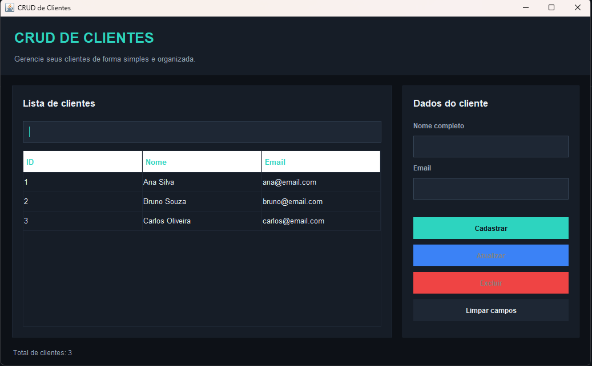

# CRUD de Clientes — Java Swing

Aplicação desktop desenvolvida em Java com interface gráfica Swing para gerenciamento de clientes.

## Funcionalidades

- Cadastro de clientes.
- Listagem em tabela.
- Pesquisa por nome ou email.
- Atualização dos dados.
- Exclusão com confirmação.
- Validação dos campos.
- Contagem de clientes cadastrados.

## Tecnologias

- Java
- Java Swing
- Programação Orientada a Objetos (POO)
- Git e GitHub

## Captura de tela

## Como executar

1. Clone este repositório.
2. Abra o projeto no IntelliJ IDEA.
3. Configure um JDK compatível.
4. Execute o método `main` da classe `Main`.

## Armazenamento

Esta versão utiliza uma lista em memória. Os dados não são mantidos após o encerramento da aplicação.

## Autor

George Bastos Ferreira Filho

Desenvolvido como projeto de estudo para praticar Java, POO e desenvolvimento de interfaces gráficas.
